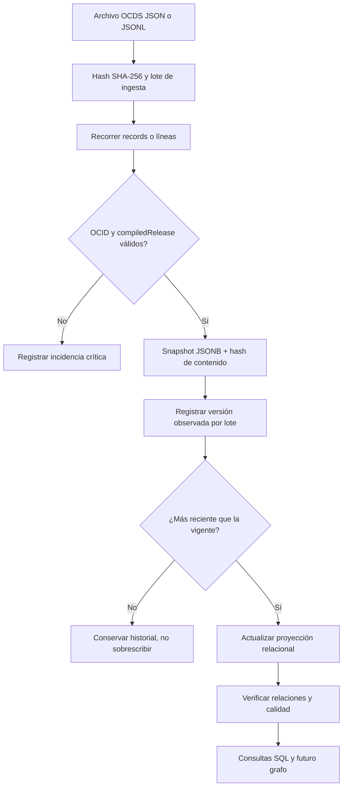

# GuateCompras Intelligence — diseño de base de datos v1.0

**Fecha de elaboración:** 2026-11-03  
**Motor objetivo:** PostgreSQL 15+  
**Estándar observado:** OCDS 1.1 con extensiones de GuateCompras  
**Estado:** **diseño implementado en archivos, pruebas sintéticas superadas; validación con JSON auténtico pendiente**.

---

## 1. Decisión ejecutiva

**Se aprueba como base de trabajo un diseño híbrido relacional + histórico JSONB**, con entidades normalizadas para consulta y un registro completo por versión del proceso. No debe usarse una única tabla para todo el JSON. La clave lógica del procedimiento es `ocid`; los registros mensuales son vistas/observaciones de procesos que pueden repetirse y modificarse. Un archivo de un mes **no es una lista universal de procedimientos nuevos** ni necesariamente una historia completa de publicaciones.

El diseño incorpora **20 tablas, 157 columnas SQL, 24 relaciones funcionales documentadas, 169 rutas OCDS mapeadas y 20 reglas de calidad**. La estructura base se entrega en `02_esquema_postgresql.sql`, el grafo ER en `03_modelo_ER.mmd`, y el diccionario completo en `diccionario_GCI.xlsx` y sus dos CSV.

## 2. Evidencia recibida y evaluación estructural

| Muestra OCDS | Registros reportados | Rutas | Conflictos de tipos detectados con las otras muestras |
|---|---:|---:|---:|
| Julio 2025 | 30,462 | 169 | 0 |
| Julio 2026 | 32,245 | 169 | 0 |
| Agosto 2026 | 30,847 | 169 | 0 |
| Septiembre 2026 | 35,401 | 169 | 0 |
| **Total acumulado** | **128,955** | **169 rutas únicas** | **0** |

Se confirma coincidencia exacta de conjuntos de rutas y conjuntos de tipos JSON observados en estos cuatro **reportes de estructura**. No se concluye de ello que otras épocas, otros formatos o todas las extensiones de OCDS tengan exactamente estas rutas. El valor `registros` se toma de la fila `$` de cada CSV y **no es una cuenta deduplicada entre archivos**.

Se observan, entre otras cosas:

- `compiledRelease.bids.details`: ofertas anidadas, con identificador propio, monto y participantes.
- `compiledRelease.awards`: adjudicaciones, cada una con ID, estado, importe y proveedores.
- `compiledRelease.contracts`: contratos y documentos asociados **muy poco frecuentes** en estas muestras (julio de 2025: 7.57%; julio 2026: 5.64%; agosto 2026: 5.08%; septiembre 2026: 1.74%). La ausencia es **campo faltante**, no prueba de inexistencia de contrato.
- `compiledRelease.tender.items`: objetos con `classification.scheme=UNSPSC`, códigos, cantidades, unidades y atributos libres.
- `compiledRelease.parties`: compradores, oferentes, proveedores y miembros de comisión de adjudicación; soporta dirección, contactos, identificadores y jerarquías.
- `releases`: referencias con URL, fecha y etiquetas; **no contienen los cuerpos completos de las publicaciones** en los reportes disponibles.

En las cuatro muestras `tender.procurementMethod` se observó como `open`; **el detalle de modalidad en Guatemala debe salir de `tender.procurementMethodDetails`** y nunca deducirse del valor general. Los valores de categorías deben mantenerse como catálogos abiertos (texto, no restricciones ENUM rígidas).

### Nota sobre indicadores

Las tasas de cobertura del reporte se calculan a nivel de registro con presencia de ruta. Las apariciones de arreglos (`awards[]`, `items[]`, `parties[]`) son **conteos de nodos**, no de identificadores globales distintos. Las estadísticas de `valores` muestran valores frecuentes **parciales**, no el dominio completo ni comprobación de claves únicas.

## 3. Unidades de información y granularidad

| Entidad | Origen OCDS | Clave lógica para deduplicación | Cardinalidad principal |
|---|---|---|---|
| Procedimiento | `$.ocid` y `compiledRelease.tender` | `ocid` | 1 por proceso |
| Versión compilada | `$.compiledRelease` + raíz | `(ocid, hash del record completo)` | 1:N por proceso |
| Observación de versión | descarga/lote + posición | `(run_id, ordinal)` | N por versión |
| Organización | `parties[].id`, refs buyer/procurer/supplier/tenderer | `org_key` = ID público completo | N:M con procesos |
| Identificador de organización | `parties[].identifier` | `(org_key, scheme, id)` | 1:N |
| Jerarquía organizacional | `parties[].memberOf[]` | `(child_org_key,parent_org_key)` | N:M |
| Contacto | `contactPoint`, `additionalContactPoints[]` | `(org_key,tipo,hash)` | 1:N |
| Rol de organización | `parties[].roles[]` y refs | `(process_id,org_key,role_code)` | N:M |
| Oferta | `bids.details[]` | `(process_id,bid_source_id)` | 1:N |
| Oferente de oferta | `bids.details[].tenderers[]` | `(bid_pk,org_key)` | N:M |
| Adjudicación | `awards[]` | `(process_id,award_source_id)` | 1:N |
| Proveedor adjudicado | `awards[].suppliers[]` | `(award_pk,org_key)` | N:M |
| Contrato | `contracts[]` | `(process_id,contract_source_id)` | 1:N, opcional |
| Ítem requerido | `tender.items[]` | `(process_id,item_source_id)` | 1:N |
| Atributo de ítem | `items[].attributes[]` | `(item_pk,attribute_source_id)` | 1:N |
| Documento | `tender.documents[]`, `contracts[].documents[]` | `(process_id,scope,owner_source_id,document_source_id)` | 1:N por dueño |
| Referencia de entrega | `releases[]` | `(process_id,release_url)` | 1:N |
| Categoría adicional / entrega | `tender.additionalProcurementCategories[]`, `submissionMethod[]` | `(process_id,kind,value)` | 1:N |
| Lote de carga | metadatos de ingesta | `run_id` | 1:N observaciones |
| Anomalía | comprobaciones de calidad | `issue_id` | 1:N por lote |

### Identificadores y reglas concretas

Los ejemplos de los reportes ilustran `ocid` como `ocds-xqjsxa-31800327`, `tender.id` como `GT-NOG-31800327`, ofertas como cadenas alfanuméricas, `awards[].id` como `GT-ADJ-...`, contratos como `NOG-...-CON-...`, y participantes con identificadores completos como `GT-NIT-...`, `GT-CISP-...`, `GT-GCUC-...`, `GT-GCID-...`.

**No se debe usar como clave primaria** el nombre de una institución, la descripción de un objeto, el monto, `compiledRelease.id` ni `contractNumber`. El número de contrato puede repetirse en entidades diferentes. Los IDs hijos se tratan como únicos **dentro del procedimiento** hasta que los JSON auténticos demuestren más o menos alcance. El ID interno `process_id` es una PK técnica; **`ocid` sigue siendo la clave de interoperabilidad**.

Como varios códigos de organización se expresan en distintos esquemas, la aplicación **no debe fusionar automáticamente `GT-CISP-...` con `GT-NIT-...`** solo por parecido de nombre o número. `memberOf` establece relaciones, no equivalencias de identidad. Cualquier resolución de identidad más ambiciosa debe ser una fase explícita, con evidencia.

## 4. Catálogo físico PostgreSQL

La base usa esquema lógico `gci`. Todas las columnas, sus tipos y nulabilidad SQL pueden consultarse en `diccionario_sql.csv` y en la pestaña **Columnas SQL** del Excel. Resumen de las 20 tablas:

| Subsistema | Tablas |
|---|---|
| Proveniencia e historia | `ingest_runs`, `process_snapshots`, `snapshot_ingestions` |
| Procedimientos y clasificaciones | `procurement_processes`, `process_categories` |
| Personas jurídicas y roles | `organizations`, `organization_identifiers`, `organization_memberships`, `organization_contacts`, `process_organization_roles` |
| Competencia y resultados | `bids`, `bid_tenderers`, `awards`, `award_suppliers`, `contracts` |
| Bienes / servicios | `tender_items`, `tender_item_attributes` |
| Evidencias | `documents`, `release_references` |
| Gobierno del dato | `data_quality_issues` |

La totalidad de las 169 rutas tiene fila en el diccionario: las hojas del JSON señaladas para extracción se traducen a columnas concretas; contenedores (`object` y `array`) se traducen a relaciones/colecciones; campos de metadatos con bajo rendimiento analítico inmediato permanecen **en `process_snapshots.raw_record`**. Esta conservación evita perder extensiones y permite migrarlas después.

### Normalización y decisiones deliberadas

El esquema intenta mantener **3FN práctica**: las ofertas no contienen filas de proveedores repetidas, las adjudicaciones no contienen columnas multi-proveedor y los atributos de ítems no son columnas dinámicas. Se crean tablas puente para N:M. Las organizaciones mantienen su ficha más reciente como una proyección, por lo cual no constituyen por sí solas un registro temporal perfecto; la versión histórica exacta de sus campos públicos sigue en los snapshots.

Las descripciones y códigos (`organization_level_id` y `organization_level_desc`, por ejemplo) se almacenan juntos en el MVP para preservar literalmente las taxonomías observadas; cuando exista un catálogo oficial y una cobertura suficiente, puede extraerse a dimensiones de referencia normalizadas.

Las cantidades e importes son `NUMERIC(30,6)` y la moneda es texto: no hay redondeos monetarios obligatorios en la base ni conversión silenciosa. Todas las fechas analíticas son `TIMESTAMPTZ`, conservando el instante temporal y sin imponer la hora de Taiwán a registros guatemaltecos. Se preservan también los textos originales dentro del JSONB.

## 5. Relaciones y ERD

El archivo `03_modelo_ER.mmd` incluye la representación Mermaid de las tablas y sus conexiones. `relaciones.csv` registra 24 relaciones de negocio y técnicas. Especial atención a:

- `organizations ↔ procurement_processes`: N:M mediante roles; un participante puede ser comprador en un proceso y proveedor en otro.
- `organizations ↔ bids`: N:M; una oferta puede, en general, contar con múltiples oferentes.
- `organizations ↔ awards`: N:M; no se presupone una sola empresa ganadora.
- `contracts → awards`: 0/1 referencia resuelta por contrato, pero se conserva siempre el `award_source_id` aunque falte la adjudicación.
- `documents → tender/contract`: el `scope` define propietario y la FK opcional verifica la relación contractual cuando corresponde.
- `process_snapshots → procurement_processes`: N:1; al consultar el estado actual se utiliza el puntero `current_snapshot_id`, no la última fila importada por casualidad.

Las FK del snapshot vigente, de la adjudicación referenciada por contrato y del documento se restringen al **mismo proceso** mediante claves compuestas. Las tablas puente poseen `UNIQUE` o PK compuesta para prevenir pares duplicados.

## 6. Historial, deduplicación y trazabilidad

Se propone el flujo:

Cada lote se identifica por URL de origen, ruta local, tipo de archivo, período si aplica y SHA-256. Cada `record` recibe un hash de su JSON canónico para evitar conservar la **misma versión lógica** dos veces. `snapshot_ingestions` permite demostrar que una versión determinada se vio en varios archivos o en sucesivas descargas. Los cambios legítimos producen nuevas filas de `process_snapshots`; la tabla de procesos conserva una proyección consultable del estado vigente. Las incidencias nunca destruyen el `raw_record` de una versión aceptada.

**Advertencia jurídica/técnica:** un JSONB reserializado no preserva necesariamente el orden de las claves, espacios ni bytes de los archivos descargados. Para evidencia verificable hay que **guardar el archivo original íntegro** (objetos con versionado + hash SHA-256). El SQL enlaza el lote con ese archivo mediante `source_path/source_uri/source_sha256`.

`publishedDate` marca prioridad temporal y `date` es alternativa. Si existen dos versiones distintas con igual marca temporal se registra conflicto y **no se elige arbitrariamente una**. Esto debe verificarse con datos reales, porque las convenciones del publicador pueden requerir una política más fina.

No se considera `releases[]` equivalente a un registro de auditoría de cambios completo: esas entradas son referencias. Si más adelante necesitamos **qué campo cambió exactamente, quién lo modificó y por qué**, habrá que recuperar releases individuales, cuando estén disponibles, y compararlos.

## 7. Calidad de datos y política de excepciones

El catálogo `reglas_calidad.csv` define 20 reglas. Son particularmente relevantes:

1. `compiledRelease.ocid` debe coincidir con el `ocid` de la raíz; sin OCID no se crea proceso.
2. IDs de hijos se validan en el ámbito de su OCID, no globalmente.
3. Los nombres, contactos y miembros de una institución pueden variar o contener duplicados: conservar texto y deduplicar solo relaciones exactas.
4. Fechas inválidas, incluidas las de `contracts.dateSigned`, se registran y se representan como NULL tipado hasta corrección, pero se preserva el texto crudo en el snapshot.
5. Ante contrato con `awardID` no resuelto se preserva `award_source_id` y se registra advertencia; **no se rechaza el contrato**.
6. No convertir ausencias de ofertas/adjudicaciones/contratos en conteos cero por defecto.
7. `tender.procurementMethodDetails` debe utilizarse para análisis guatemalteco; `open` solo es una categoría OCDS general.
8. Un rol publicado como `awardComiteeMember` se conserva exactamente con esa grafía, sin reinterpretarlo silenciosamente.
9. `application/pdf` y `application/PDF` se conservan como valores fuente; la búsqueda podrá normalizarlos aparte.
10. `numberOfTenderers` se contrasta, cuando hay ofertas, contra los identificadores distintos de `bids.details[].tenderers`. Una discordancia requiere inspección, **no implica corrupción**.

El registro público de Open Contracting Partnership para Guatemala documenta problemas de duplicados en `tender/tenderers` y `parties/additionalContactPoint`, y fechas de contrato mal formadas. Estos riesgos justifican explícitamente la política anterior: https://data.open-contracting.org/es/publication/142

## 8. Cobertura y sesgos del conjunto OCDS

La publicación OCDS guatemalteca excluye explícitamente publicaciones NPG, NOG anteriores al 01-01-2020, y registros de ejecución/pagos provenientes de sistemas financieros administrativos. Por tanto **GuateCompras Intelligence no podrá ofrecer una vista universal de todo el gasto público usando únicamente estos OCDS**. Habrá que integrar otras fuentes en fases posteriores y etiquetar siempre el origen y la cobertura de los indicadores.

La fuente se publica bajo licencia **CC BY 4.0**, conforme al registro público OCP: se debe incorporar atribución y enlace a la fuente, y distinguir claramente nuestros cálculos y transformaciones de los datos oficiales.

## 9. Preparación para Knowledge Graph

No es necesario introducir un motor gráfico en el MVP. PostgreSQL ya representa las aristas principales. Un módulo futuro puede emitir nodos tipados `Process`, `Organization`, `Bid`, `Award`, `Contract`, `Item`, `Document` desde las PK y claves públicas; y aristas como `BUYS`, `TENDERS_FOR`, `SUPPLIES`, `AWARDED_IN`, `CONTRACTS`, `MEMBER_OF`, `CONTAINS_ITEM` y `HAS_DOCUMENT`. Cada arista exportada deberá apuntar a un **OCID, snapshot_id y campo de procedencia**, no solo a un nombre.

En detección explicable de anomalías deben observarse la modalidad, el valor de la moneda, el número de oferentes declarados, la integridad de los vínculos y los sesgos de cobertura. La falta de documento, adjudicación o competencia no será una imputación de conducta irregular por sí sola.

## 10. Validación: ejecutado y pendiente

### Ejecutado en esta entrega

- Comparación estructural reproducible de cuatro CSV: **169 rutas idénticas, 0 conflictos de tipos, 128,955 registros contados en archivos fuente**.
- Generación y comprobación del diccionario de rutas, columnas, relaciones y reglas.
- Generación del SQL con PK, FK, `UNIQUE`, índices de consultas y restricciones de ámbito de proceso.
- Pruebas unitarias contra fixtures **ficticios**, que incluyen procesos con múltiples versiones, sin contratos, con vínculos sin resolver, duplicados y una fecha inválida.
- Verificación de sintaxis de Python mediante `py_compile` y ejecución del análisis estructural.

### No ejecutado y por tanto no certificado

- **Importación real de JSON OCDS:** no se adjuntó ningún JSON ni JSONL original, solo reportes agregados.
- **Prueba de ejecución SQL y FK sobre PostgreSQL en esta sesión:** no hay servidor PostgreSQL instalado/conectado en el entorno de trabajo.
- Medición real de colisiones de ID entre procesos, huérfanos, latencia de ingesta, rendimiento en archivos grandes, consistencia de tipos/fechas/monedas a nivel de valor.
- Verificación contra el esquema JSON oficial y extensiones con un validador OCDS externo. 

**Criterios de aceptación para cerrar v1:** cargar al menos 100, luego 1,000 registros auténticos y el conjunto completo de un mes; resolver errores críticos; demostrar que duplicar un mismo archivo no crea procesos ni snapshots nuevos; demostrar que importar un archivo anterior no revierte el estado vigente; recuperar con SQL un proceso con su comprador, proveedores, ofertas, adjudicaciones, contratos y documentos; comprobar que una alerta de calidad puede rastrearse al archivo y al snapshot fuente.

## 11. Lista ordenada de implementación

1. Instalar PostgreSQL 15+ y crear base `gci`.
2. Ejecutar `02_esquema_postgresql.sql` una vez sobre una BD vacía.
3. Conservar y respaldar un JSON real de un mes con su SHA-256; **no sustituirlo** por un CSV de perfil estadístico.
4. Ejecutar `04_importador_ocds.py --check-only --limit 100` sobre datos originales; inspeccionar incidencias.
5. Importar primeros 100 en una BD de desarrollo, ejecutar `05_consultas_validacion.sql` y comparar contra el JSON.
6. Repetir con 1,000 y con el mes completo, medir tiempos y registrar casos no modelados.
7. Reimportar idéntico archivo y después una edición/versión anterior para demostrar idempotencia y no regresión temporal.
8. Ajustar restricciones que los datos desmientan; migrar con archivos numerados en lugar de editar retrospectivamente una BD en producción.
9. Publicar vistas/consultas de transparencia y, luego, la extracción a grafo con evidencia por arista.

## 12. Referencias públicas

- OCDS 1.1.5 — esquema oficial de entrega: https://standard.open-contracting.org/latest/es/schema/release/
- Registro público OCP, Guatemala (licencia, cobertura, calidad): https://data.open-contracting.org/es/publication/142
- Portal oficial de GuateCompras OCDS: https://ocds.guatecompras.gt/descarga-datos
- Cuatro reportes entregados por el usuario: `fuentes/*.csv`

---

**Resultado:** el diseño lógico y físico inicial está realizado; la única fase cuya aceptación no es posible con la evidencia adjunta es **validar la implementación sobre registros reales en PostgreSQL**. El importador, la prueba estática y los criterios de aceptación quedan preparados para completarla en cuanto exista un archivo OCDS original.
